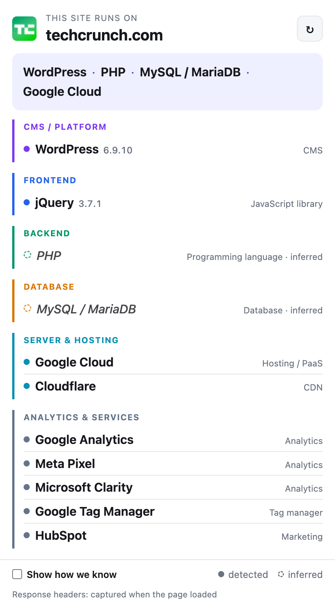
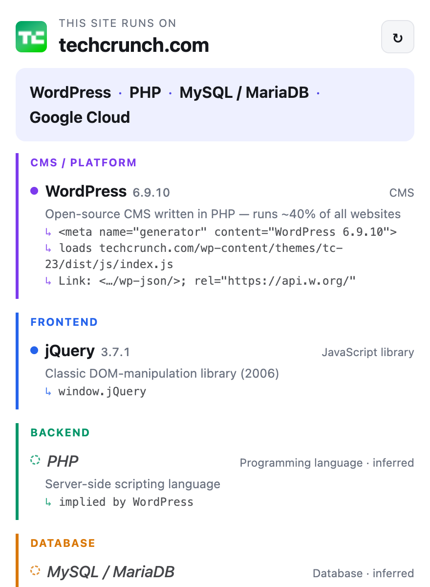

# StackScope

**What is this website built on?** One click shows a site's tech stack — CMS, frontend framework, backend, database, server and hosting — and *how* each was detected.

A simplified, open-source take on tools like Wappalyzer, made for teaching: clear categories, big readable names, and a "Show how we know" switch that turns every result into a lesson about HTTP headers, cookies, JavaScript globals and HTML fingerprints.

  
  &nbsp;
  

---

## Install in 2 minutes

Works in **Google Chrome**, **Microsoft Edge**, **Brave**, **Arc** and other Chromium browsers. No account, no git, nothing to compile.

### 1. Download

👉 **[Download StackScope (zip)](https://github.com/tomimester/stackscope/archive/refs/heads/main.zip)**

Double-click the zip to unpack it. You get a folder called **`stackscope-main`** (you can rename it to `stackscope` if you like).

> **Important:** put that folder somewhere permanent (e.g. Documents), *not* in Downloads where it might get cleaned up. The browser loads the extension from this folder every time it starts — if the folder is deleted or moved, the extension disappears.

### 2. Open the extensions page

Type this in the address bar and press Enter:

| Browser | Address |
|---|---|
| Chrome | `chrome://extensions` |
| Edge | `edge://extensions` |
| Brave | `brave://extensions` |

### 3. Turn on Developer mode

Flip the **Developer mode** switch (top-right corner in Chrome, left sidebar in Edge).

### 4. Load the extension

Click **Load unpacked** → select the **`stackscope-main`** folder from step 1 (the one that contains `manifest.json`) → **Select**.

StackScope now appears in your list of extensions.

### 5. Pin it to the toolbar

Click the puzzle-piece icon 🧩 next to the address bar, then the pin 📌 next to **StackScope**.

### 6. Try it

Open any website and click the StackScope icon. Good first tries:

| Website | What you'll see |
|---|---|
| [techcrunch.com](https://techcrunch.com) | WordPress · PHP · MySQL |
| [nextjs.org](https://nextjs.org) | Next.js · React · Node.js · Vercel |
| [nuxt.com](https://nuxt.com) | Nuxt · Vue.js · Vercel |
| [angular.dev](https://angular.dev) | Angular |
| [svelte.dev](https://svelte.dev) | SvelteKit · Svelte · Vercel |
| [drupal.org](https://www.drupal.org) | Drupal · PHP · Apache |
| [wix.com](https://www.wix.com) | Wix · React |

> Tabs that were already open *before* you installed StackScope: **reload them once**. Server headers are only captured when a page loads, so until then the popup shows everything else and asks you to reload. (StackScope never re-requests a page on its own — a second visit could use up one-time links like magic logins or password resets.)

### Updating to a new version

Download the zip again, replace the old folder with the new one (keep the same name and location), then click the **↻ reload** icon on StackScope's card on the extensions page.

---

## Reading the results

- **The box at the top** is a one-line summary — handy on a projector.
- **● Solid dot = detected.** Direct evidence was found on the page or in the server's response.
- **◌ Dashed dot = inferred.** Implied by something else: WordPress ⇒ PHP + MySQL, Next.js ⇒ React + Node.js.
- **Show how we know** reveals the evidence for each item, e.g. `X-Powered-By: PHP/8.2`, `window.__NEXT_DATA__`, `cookie "laravel_session"`.
- **Empty Backend or Database section?** That's a result too: well-configured servers hide their backend, and databases are never directly visible from the browser.

## How it works

StackScope combines four kinds of clues:

| Clue | Example | Where it's checked |
|---|---|---|
| HTTP response headers | `Server: nginx`, `X-Powered-By: Express`, `cf-ray` | `background.js` records them, `rules.js` → `analyzeHeaders` |
| Cookie names | `PHPSESSID`, `laravel_session`, `JSESSIONID` | `rules.js` → `analyzeCookies` |
| JavaScript globals | `window.__NEXT_DATA__`, `window.jQuery`, `window.Shopify` | `detect.js` |
| HTML / DOM fingerprints | `<meta name="generator">`, `/wp-content/` URLs, `ng-version`, `data-v-*`, React fibers | `detect.js` |

`rules.js` also holds the technology catalog: each technology's category, what it implies, and a one-line description.

### Adding a technology

1. Add it to `TECH` in `rules.js` (category, optional `implies`, short `desc`).
2. Add a detection rule — in `detect.js` for page clues, or in `analyzeHeaders` / `analyzeCookies` in `rules.js` for server clues.
3. Click ↻ on the extension's card in `chrome://extensions` and test.

Pull requests are welcome.

## Privacy

Everything runs locally in your browser. StackScope sends no data anywhere, has no analytics, and reads only cookie *names* (never their values). It needs access to all sites only so it can inspect whichever page you click it on.

## License

[MIT](LICENSE)
